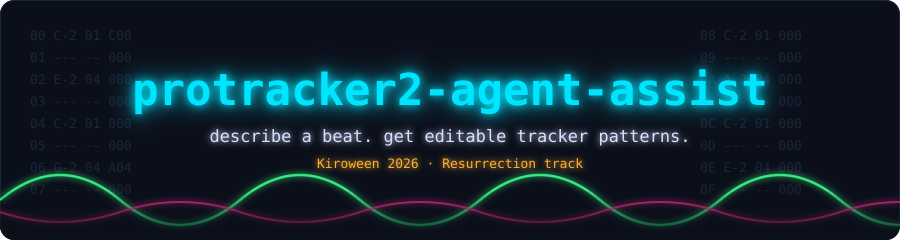
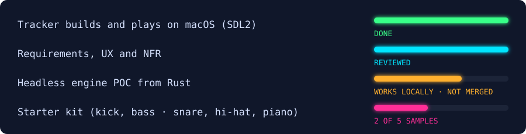
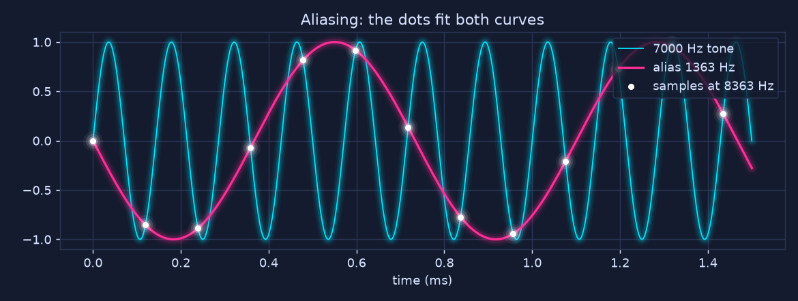
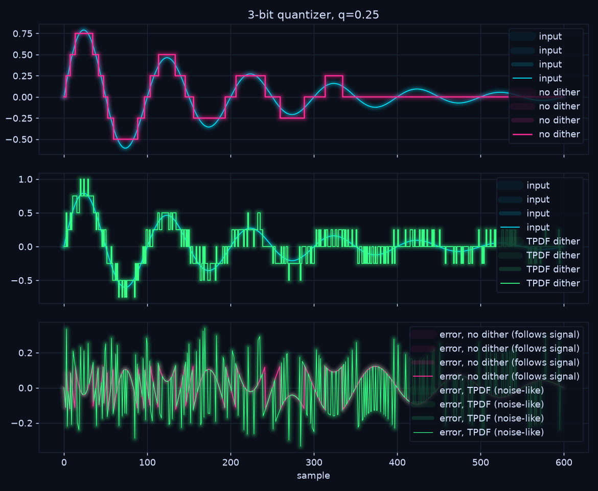
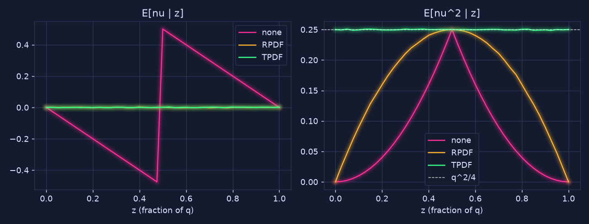

  

  
  
  
  

An agent-assisted ProTracker 2-style tracker, built on an open-source ProTracker 2 replayer (see [Credits](#credits-and-licence)). You describe a beat, a bassline or a harmonic twist in plain language, and the agent writes editable tracker patterns back into the grid.

Built for the **Kiroween** hackathon (Resurrection track) with Kiro CLI and Kiro Crew.

**Website:** [kizouker.github.io/protracker2-agent-assist](https://kizouker.github.io/protracker2-agent-assist/)

- **Creative co-pilot, not a jukebox.** The agent produces pattern data you can edit, never flat audio renders or copies of existing songs.
- **Clean core library (`libpt2`).** The `pt2-clone` audio, replayer and module I/O sit behind a small library boundary, wrapped from Rust, so upstream fixes stay easy to pull.
- **Own starter sample kit.** A small 8-bit kit (kick, snare, hi-hat, bass, piano) recorded by the author, so pattern generation works out of the box.

ProTracker plays 8-bit mono samples, and 8363 Hz is the rate that plays back at the note C-2. Modern recordings (24-bit, 48 kHz, often stereo) are converted in four steps:

1. **Stereo to mono.** Average the channels: $x_m = \tfrac12(x_L + x_R)$.
2. **Low-pass, then resample to 8363 Hz.** Everything above the Nyquist frequency of 4181.5 Hz is filtered out first. Otherwise it folds down as aliasing: a 7000 Hz tone becomes $|7000 - 8363| = 1363$ Hz.
3. **Normalise** the peak to −0.3 dBFS, so the 256 levels are used fully.
4. **TPDF dither, then round to 8 bits.** Adding triangular noise of about ±1 step makes the rounding error independent of the signal. Distortion becomes a steady noise floor, at a cost of about 4.8 dB (SNR ≈ 45 dB for a full-scale sine instead of ≈ 50 dB).

  
  
  

What is lost: everything above about 4 kHz, some attack sharpness, and the noise floor. Kick and bass keep most of their character because their energy sits below 1 kHz.

The full derivation, with formulas and figures, is on the [sample conversion page](https://kizouker.github.io/protracker2-agent-assist/sample-conversion/). Sources: [`docs/sample-conversion/`](docs/sample-conversion/).

| Path | Contents |
|---|---|
| `src/` | Upstream `pt2-clone` source (kept unmodified) |
| `docs/` | Vision, requirements and the project website |
| `docs/sample-conversion/` | 8-bit conversion explained, with the script that renders the figures |
| `assets/starter-kit/` | Starter samples and their provenance |
| `docs/upstream/pt2-clone-README.md` | The original `pt2-clone` README: releases, keybindings, compiling |

- [Vision](docs/vision.md)
- [Non-functional requirements](docs/non-functional-requirements.md)
- [UX requirements](docs/ux-requirements.md)
- [To-do list](docs/todo.md)

Building the tracker is unchanged from upstream. See [`HOW-TO-COMPILE.txt`](HOW-TO-COMPILE.txt) and the [original README](docs/upstream/pt2-clone-README.md).

ProTracker 2 clone by Olav "8bitbubsy" Sørensen: [`8bitbubsy/pt2-clone`](https://github.com/8bitbubsy/pt2-clone). See [`LICENSE`](LICENSE) and [`LICENSES.txt`](LICENSES.txt). The starter samples are the author's own recordings; see [`assets/starter-kit/PROVENANCE.md`](assets/starter-kit/PROVENANCE.md).
