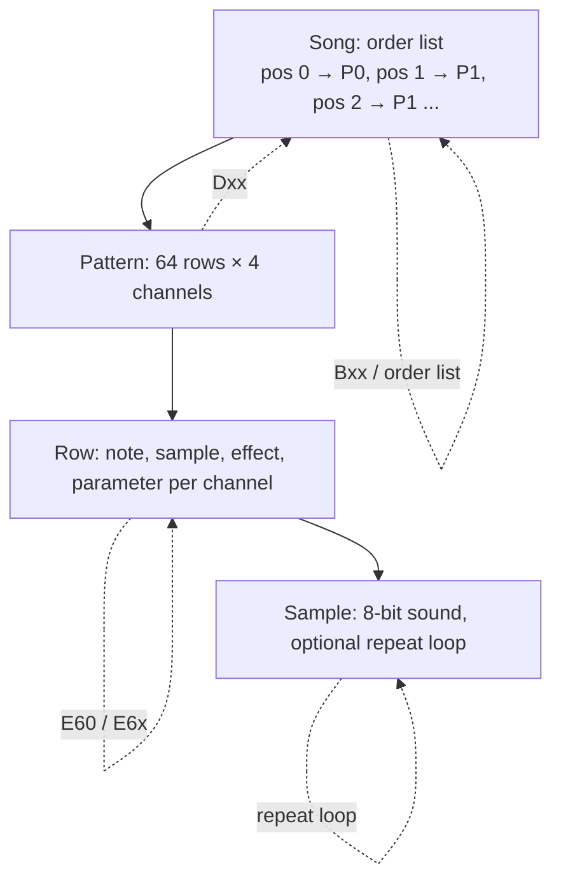
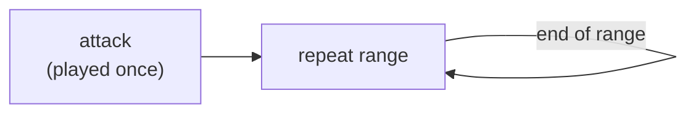
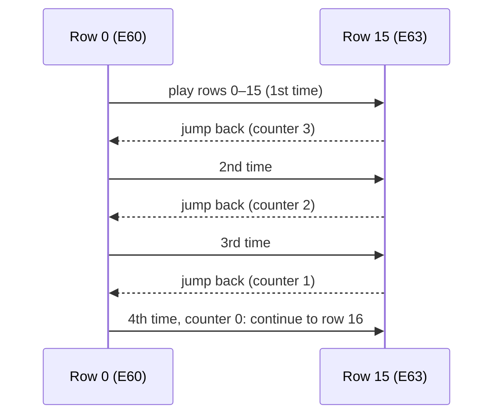
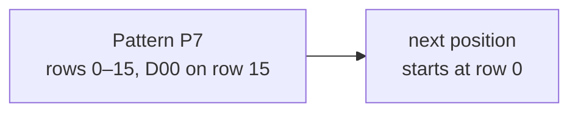
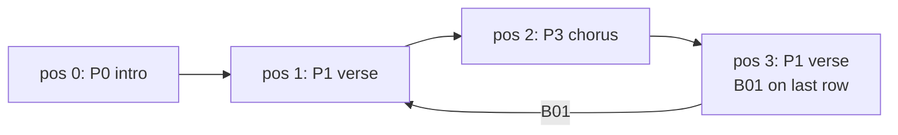

# NAME

pt2-loops – the four kinds of loops in a ProTracker MOD

# SYNOPSIS

| Level | Effect / field | Repeats |
|---|---|---|
| Sample | repeat start + repeat length | one sound while it rings |
| Rows in a pattern | `E60` … `E6x` | a range of rows, x more times |
| Pattern length | `Dxx` | ends the pattern early, starts the next at row xx |
| Song | `Bxx`, or the order list | jumps back in the song, or forever |

# DESCRIPTION

A MOD plays a song as a list of positions (the **order list**). Each position points to a **pattern** of 64 **rows**. Each row has 4 **channels**. Each channel plays one **sample** at a time. A loop can live on each of these levels.



## 1. Sample loop

Each sample has a **repeat start** and a **repeat length**. When playback reaches the end of the repeat range, it jumps back to the repeat start and keeps going until a new note, a note cut (`ECx`) or volume 0 stops it. A repeat length of 2 bytes means "no loop" (one-shot sample).



Use it for: pads, shakers, organ, any held sound. Set the loop points where the waveform crosses zero, or it clicks.

## 2. Pattern loop: `E60` and `E6x`

- `E60` on a row marks the **loop start** for that channel.
- `E6x` (x = 1…F) on a later row jumps back to the loop start **x more times**.

So `E63` plays the range **4 times in total**.



Example: one bar of Rio zouk (16 rows) played 4 times without copying it.

```
row  ch1 (kick/rim)   ch2 (hat)       effect
00   C-2 01           C-3 03          E60     ← loop start
04   C-2 0A           C-3 03
06   C-2 01           C-3 03
08   C-2 01           C-3 03
12   C-2 0A           C-3 03
14   C-2 01           C-3 03
15   ---              ---             E63     ← back 3 times
16   ...                                       ← after 4 plays
```

Rules (from `src/pt2_replayer.c`, `jumpLoop()`):
- The effect acts on tick 0 of the row.
- The loop start is stored **per channel**, but the jump moves the **whole pattern**. Put `E60`/`E6x` on one channel only.
- No nesting: one loop per channel at a time.

## 3. Pattern break: `Dxx`

`Dxx` ends the current pattern after this row and starts the **next order position** at row **xx**. The parameter is written in decimal digits: `D16` means row 16, not row 0x16. A value above 63 becomes row 0.

Use it to make a short pattern, for example a 1-bar loop pattern:



A 3/4 bar at 4 rows per beat is 12 rows. Four bars = 48 rows: put `D00` on row 47.

## 4. Song loop: order list and `Bxx`

The **order list** says which pattern plays at each position. Writing the same pattern number several times repeats it at no cost.

`Bxx` jumps to position **xx** (hex) of the order list, starting at row 0. Pointing it back to an earlier position makes the song loop forever.



# A STEP-SEQUENCER LOOP

A loop drawn left to right in a step sequencer (ABL-4, UX horizontal view) is saved in the MOD like this:

| You want | Written as |
|---|---|
| Loop 1 bar N times inside a pattern | `E60` on the first row, `E6(N-1)` on the last row |
| A pattern that is only 1 bar long | `D00` on row 15 |
| Loop forever | the pattern in the order list, `Bxx` back to it |

# PITFALLS

- `E6x` on two channels at once: the jumps interfere. The Validator (APG-19) rejects it.
- `Dxx` and `Bxx` on the same row: `Bxx` picks the position, `Dxx` the start row. The result depends on channel order, so put both on the same channel or avoid it. (To verify with a render test.)
- A sample loop that does not start at a zero crossing clicks on every repeat.
- `E6x` with no `E60` before it jumps to the channel's last stored loop start, which may be from an earlier pattern. (To verify.) Always write `E60`.

# SEE ALSO

pt2-effects(7), pt2-order-list(7), pt2-samples(7)

[ProTracker 2.3D helpfile manual](https://github.com/echolevel/Protracker-2.3D-Helpfile-Manual), [MOD file format](https://en.wikipedia.org/wiki/MOD_(file_format))
