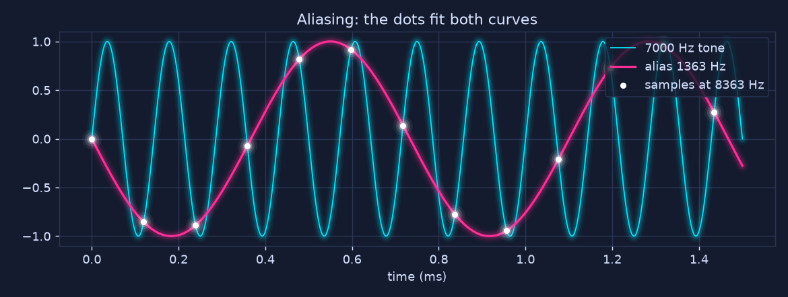
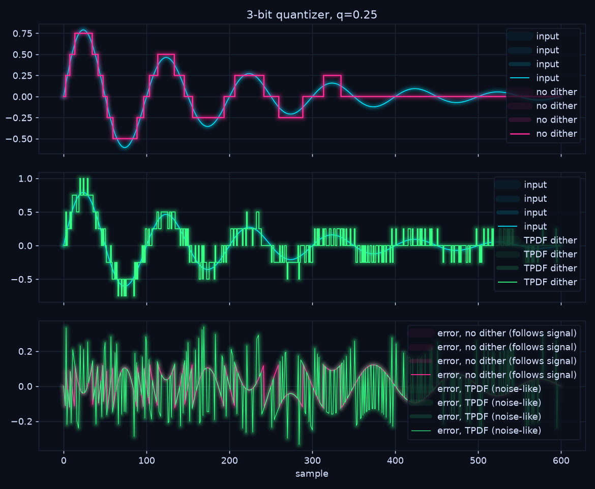
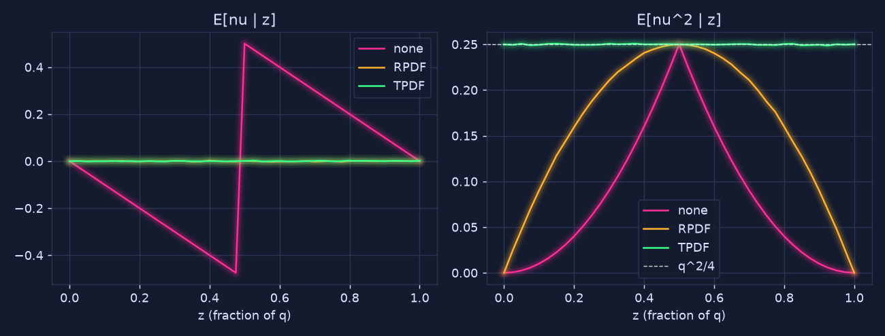

<script>window.MathJax={tex:{inlineMath:[['\\(','\\)'],['$','$']],displayMath:[['\\[','\\]'],['$$','$$']]}};</script>
<script src="https://cdn.jsdelivr.net/npm/mathjax@3/es5/tex-chtml.js" async></script>

How a modern recording (24-bit, 48 kHz, often stereo) becomes a ProTracker sample (8-bit, mono, 8363 Hz, which plays at the note C-2).

**Try it live:** [interactive simulations](simulations.html) of aliasing, dither and the error moments.

Notation: input $x_L[n], x_R[n]$ at $f_i = 48000$ Hz, output rate $f_o = 8363$ Hz, 8-bit step $q = 2/2^8 = 2^{-7}$ on the range $[-1, 1)$.

## 1. Stereo to mono

$$x_m[n] = \tfrac12\bigl(x_L[n] + x_R[n]\bigr) \tag{1}$$

Content that is out of phase between the channels cancels. Kick and bass sit in the centre, so they lose nothing.

## 2. Low-pass, then resample

Sampling at $f_o$ repeats the spectrum at every multiple of $f_o$:

$$X_s(f) = f_o \sum_{k \in \mathbb Z} X(f - k f_o) \tag{2}$$

Where the copies overlap, you get aliasing. A tone at $f$ appears at

$$f_a = \bigl|\, f - f_o \,\mathrm{round}(f / f_o) \bigr| \tag{3}$$

so 7000 Hz becomes $|7000 - 8363| = 1363$ Hz. After sampling, these points are identical to a real 1363 Hz tone, so the filter must act **before** sampling: $|H(f)| \approx 0$ for $|f| \ge f_o/2 = 4181.5$ Hz.



A sharper filter edge means less aliasing but a longer filter, which rings slightly before transients (pre-ringing).

## 3. Normalise

$$z[m] = g\, y[m], \qquad g = \frac{10^{-0.3/20}}{\max_m |y[m]|} \approx \frac{0.966}{\max_m |y[m]|} \tag{4}$$

8 bits give 256 levels, about 6 dB per bit and 48 dB in total. A quiet sample uses only a few of them.

## 4. Dither, then round to 8 bits

The quantizer rounds to the nearest step:

$$Q(u) = q \left\lfloor \frac{u}{q} + \frac12 \right\rfloor \tag{5}$$

**Without dither**, the error $e = Q(z) - z$ is a fixed function of the signal. It follows the music and sounds like distortion, and quiet tails turn into steps or cut to silence.

**With TPDF dither**, two independent uniform values are added before rounding:

$$d = u_1 + u_2,\quad u_i \sim \mathcal U\!\left(-\tfrac q2, \tfrac q2\right), \qquad w = Q(z + d), \qquad \nu = w - z \tag{6}$$

The error then has a mean and a variance that do not depend on the signal:

$$\mathbb E[\nu \mid z] = 0, \qquad \mathbb E[\nu^2 \mid z] = \frac{q^2}{12} + \frac{q^2}{6} = \frac{q^2}{4} \tag{7}$$



### Why two uniform values and not one

The quantizer error is periodic in $u$ with period $q$, so it has a Fourier series with frequencies $a_k = 2\pi k / q$. Averaging over the dither multiplies each term by the dither's characteristic function $\Phi_d(a_k)$. The mean error vanishes for every $z$ when $\Phi_d(a_k) = 0$, and the variance stops depending on $z$ when also $\Phi_d'(a_k) = 0$, for all $k \ne 0$.

One uniform value has $\Phi_u(\omega) = \dfrac{\sin(\omega q/2)}{\omega q/2}$: simple zeros at $a_k$, so the mean is fixed but the variance still moves with the signal (RPDF dither). The sum of two independent ones has

$$\Phi_d(\omega) = \Phi_u(\omega)^2 = \left(\frac{\sin(\omega q/2)}{\omega q/2}\right)^2 \tag{8}$$

with a double zero at every $a_k$, so both conditions hold. A Monte Carlo check (200 000 draws per point) confirms it:



## Signal-to-noise ratio

For a full-scale sine ($P_s = \tfrac12$):

$$\mathrm{SNR}_{\text{plain}} = 10 \log_{10} \frac{1/2}{q^2/12} \approx 49.9 \text{ dB}, \qquad \mathrm{SNR}_{\text{TPDF}} = 10 \log_{10} \frac{1/2}{q^2/4} \approx 45.2 \text{ dB} \tag{9}$$

Dither costs 4.8 dB of noise and removes distortion that follows the signal.

## What is lost, and why kick and bass survive

Everything above about 4 kHz goes, the attack gets a little softer, and a noise floor appears around −45 to −50 dB. Kick and bass have most of their energy below 1 kHz, so the filter barely touches them, and their loud, short shape masks the noise.

## From formula to code

| Equation | In `scripts/demo.py` | In the SoX chain |
|---|---|---|
| (1) mono | n/a | `remix 1` |
| (2)–(3) aliasing | figure 1 | `rate -v 8363` |
| (4) normalise | n/a | `gain -n -0.3` |
| (5) quantizer | `quant(u, q)` | `-b 8` |
| (6)–(8) TPDF dither | figures 2 and 3 | `dither` (TPDF by default, placed last) |

Plain `dither` is used on purpose: SoX's noise-shaping variant (`dither -s`) only has filters for some sample rates, and 8363 Hz is not one of them.

## Re-render the figures

```bash
cd docs/sample-conversion/scripts
uv run --with numpy --with matplotlib demo.py
```

The script writes the three PNG files to `../figures/`, which updates this page. Edit `quant()` or the dither lines to see how the error changes.

## References

BibTeX for everything below: [references.bib](references.bib).

- **Sampling and aliasing:** Nyquist (1928), Shannon (1949); Söderkvist, *Tidsdiskreta signaler & system* (Linköping), a Swedish textbook on sampling and discrete-time systems; Oppenheim and Schafer, *Discrete-Time Signal Processing* (3rd ed., 2010); Crochiere and Rabiner, *Multirate Digital Signal Processing* (1983) for non-integer rate conversion.
- **Dither:** Wannamaker, Lipshitz, Vanderkooy and Wright, "A Theory of Nonsubtractive Dither", *IEEE Trans. Signal Processing* 48(2), 2000. The derivation above follows it. See also Lipshitz, Wannamaker and Vanderkooy, "Quantization and Dither: A Theoretical Survey", *JAES* 40(5), 1992, and Widrow and Kollár, *Quantization Noise* (2008).
- **Digital audio in practice:** Huber and Runstein, *Modern Recording Techniques* (7th ed., 2010); Rumsey and McCormick, *Sound and Recording: An Introduction* (5th ed., 2006).
- **Sampling culture:** Schloss, *Making Beats: The Art of Sample-Based Hip-Hop* (2014).
- **Tools and platform:** the SoX manual (`rate`, `dither`); the *Amiga Hardware Reference Manual* (1989 edition, for Kickstart 1.3) for the Paula chip. The 8363 Hz rate is the NTSC Amiga clock, 3 579 545 Hz, divided by the C-2 period 428.
